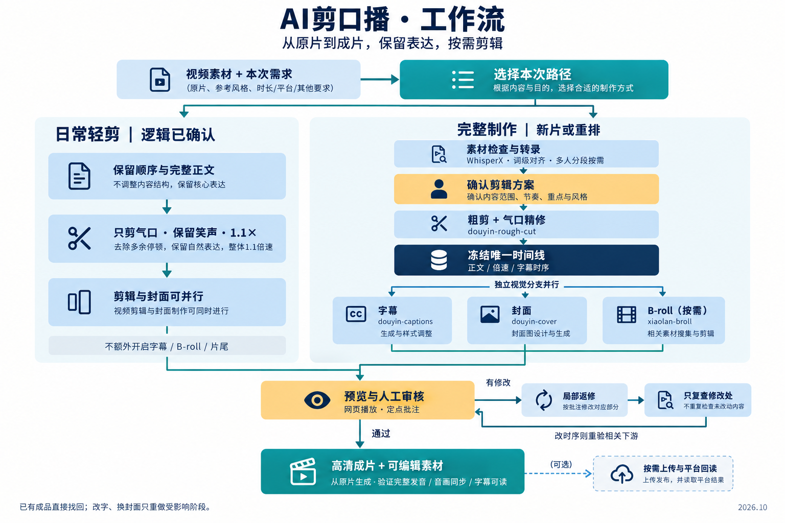

# Peter Agent Skills｜公开版

这里收录已经确认可公开的 Agent Skills。

## AI剪口播

[查看 Skill 与使用说明](AI剪口播/README.md) · [Skill 入口](AI剪口播/SKILL.md)



支持日常轻剪、完整制作、网页批注审核、局部返修与高清交付。配套 skill 和服务依赖见技能 README，按实际启用路径配置。

安装时复制 AI剪口播 目录到 coding agent 的 skills 目录。

每个技能保留自己的许可；AI剪口播 沿用 AGPL-3.0 与原作者署名。

## Peter Expression｜简历写作与项目表达

[独立求职仓库](https://github.com/Guanbin-Huang/antiboomer-jobseeking-skill) · [查看功能与用法](https://github.com/Guanbin-Huang/antiboomer-jobseeking-skill/blob/main/README.md) · [Skill 入口](https://github.com/Guanbin-Huang/antiboomer-jobseeking-skill/blob/main/SKILL.md)


两大功能：**简历怎么写**（融合 ASu 的岗位匹配与经历重组），以及 **逐字稿＋项目文档**。共用事实底稿与 Agent/具身智能领域路由，保留 ASu 来源和 MIT 许可。

Peter Expression 的唯一维护源是独立仓库 `antiboomer-jobseeking-skill`；本仓库的 `peter-ai-interview-expression/` 是 Git submodule 索引，不维护重复副本。

```bash
git clone --recurse-submodules https://github.com/Guanbin-Huang/peter-agent-skills-public.git
# 已克隆总仓库时：
git submodule update --init --recursive
```

安装时复制展开后的 `peter-ai-interview-expression` 目录到 coding agent 的 skills 目录。协作者在独立求职仓库提交；独立仓库更新后，总仓库需另行提交 submodule 版本指针。

## Feishu Course｜从会议到课程

[独立仓库](https://github.com/Guanbin-Huang/feishu-course-from-meetings) · [功能与安装](https://github.com/Guanbin-Huang/feishu-course-from-meetings/blob/main/README.md) · [Skill 入口](https://github.com/Guanbin-Huang/feishu-course-from-meetings/blob/main/SKILL.md)


把飞书课堂的完整逐字稿整理成学员版课程：找原稿、串起跨课主线、生成课程地图与逐讲笔记、附上原稿和回看入口，写入后回读正文与权限。已有课程依据清单处理新增课堂，保留原链接与手工内容。

`feishu-course-from-meetings/` 是指向独立仓库的 Git submodule；公开版本在独立仓库维护，本仓库只提交版本指针。安装时使用上面的递归克隆命令，或直接克隆独立仓库到 `~/.codex/skills/feishu-course-from-meetings`。飞书 CLI 与配套 Skill 依赖见独立仓库 README。
