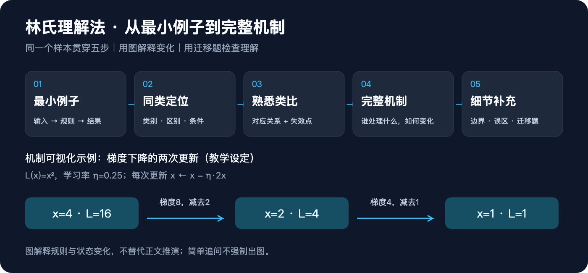
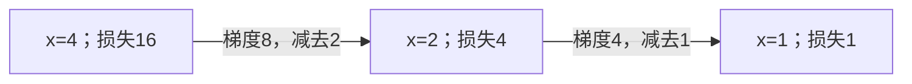

# 林氏理解法（lin-concept）

用同一个最小例子，按 **toy sample → 同类定位 → 熟悉类比 → 完整数据流／机制链 → 细节补充** 解释复杂概念。适用于技术、数学、科学、经济和管理主题；目标是让读者能推演过程，而不只是记住定义。



## 五步分别做什么

| 步骤 | 交付内容 |
| --- | --- |
| 1. 最小例子 | 用 2–4 个对象或变量展示输入、规则、一次变化和结果 |
| 2. 同类定位 | 说明所属类别，与易混概念比较关系、条件和代价 |
| 3. 熟悉类比 | 给出操作对应关系，并说明类比在哪失效 |
| 4. 完整机制 | 沿用同一例子，逐步交代谁处理什么、如何变化、交给谁 |
| 5. 细节补充 | 补齐成立条件和误区，用迁移题与参考答案检查能否推演 |

## 可视化如何使用

仓库首页的图介绍方法；实际讲解中的图解释目标概念，二者用途不同。完整五步讲解遇到状态变化、多步骤流转、层级或易混关系时，默认至少配一张机制图。不要求每一步都画图；一句话定义、单点追问或纯文字要求不强制出图。

图与正文使用同一组数据，标明操作规则和阶段。默认优先流程图、时序图、状态图或关系图，不用装饰图代替解释。GitHub 支持下列 Mermaid 示例；其他环境按 [可视化规范](references/visualization.md) 选择可读图或图像文件。

### 示例：梯度下降的两次更新

教学设定：L(x)=x²，初值 x=4，学习率 η=0.25；每次按 x新=x旧−0.25×2x旧 更新。



每次先按当前位置计算梯度，再更新 x，所以第二次减少 1 而不是 2。该例只展示机制，不保证其他目标函数或学习率也收敛。若学习率改为 1，x 会在 4 与 −4 之间往复，损失保持 16。

## 安装与调用

在本仓库根目录，将 `lin-concept` 目录复制到 Agent 的 skills 目录。Codex 示例（目标尚不存在时）：

```bash
mkdir -p ~/.codex/skills
cp -R lin-concept ~/.codex/skills/
```

已有安装时，先备份旧目录，再替换；不要将新目录嵌套复制进旧目录。

```text
使用 lin-concept（林氏理解法），帮我理解【概念】。
我知道【基础】，卡在【问题】，希望用于【场景】。
按最小例子→同类→类比→完整机制→细节补充讲。
用同一组具体数据贯穿，配一张机制图，说明类比边界，最后给一道迁移题。
```

用户只追问某一点时只补相关步骤；要求逐步互动时每轮推进一步。Skill 不自动创建长期学习计划。生成了讲解不等于学生已掌握，掌握程度须依据实际作答。

## 文件入口

- [SKILL.md](SKILL.md)：Agent 执行入口。
- [可视化规范与示例](references/visualization.md)：出图条件、图型、呈现与图文一致性。
- [FM 案例边界](references/fm-boundaries.md)：FM、Diffusion 等主题的概念边界。
- [跨领域示例](references/transfer-example.md)：避免把非技术概念硬套算法。
