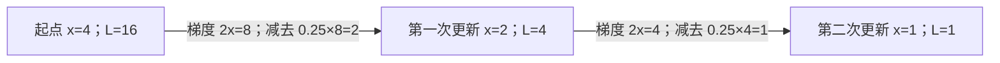

# 可视化规范与示例

## 何时出图

完整五步解释涉及多步骤流转、状态变化、层级或易混关系时，默认至少一张机制图；用户明确要求画图时必须出图。简单定义、单点追问或用户要求纯文字时不强制配图。不要把五张装饰卡片当成机制解释。

## 图型与位置

| 步骤 | 适合的图 | 必须说清什么 |
| --- | --- | --- |
| Toy sample | 前后状态图 | 输入、一次操作、输出 |
| 同类定位 | 关系图或比较表 | 包含、替代、组成或可组合；不能混淆分类轴 |
| 熟悉类比 | 两列映射图或表 | 操作如何对应，以及类比失效点 |
| 完整机制链 | 流程图、时序图或状态图 | 谁拿到什么、执行什么规则、交给谁；多阶段分开 |
| 细节补充 | 条件分支图 | 条件改变后结果为什么改变 |

只选有解释价值的图，不要求五步各画一张。将图放在对应步骤旁，并用正文带读者走过图中的一个具体变化。

## 呈现方式

- GitHub README 优先嵌入仓库内的 PNG／SVG，保证读者直接看到图；Mermaid 用于可编辑的机制示例。
- 对话支持 Mermaid 时直接输出完整 Mermaid 图。环境不渲染 Mermaid 时，用可直接阅读的文本箭头图；用户明确要求图像文件时生成并回读 SVG／PNG，按当前平台附件流程交付。
- 用户要求交互式 visualization 时生成可独立打开的 HTML／SVG；只有操作、参数或时间变化有教学价值时才加交互，不为普通概念强制创建网页。
- 节点写对象、状态或动作，箭头写规则、数据或条件。避免只画“输入→系统处理→结果”。
- 教学数字标明教学设定；图示不冒充实验结果。图文共用变量、单位、时间约定。源码、渲染成功和附件交付分别核验，不混报。

## 示例：用同一个最小样本解释梯度下降

教学设定：最小化 L(x)=x²，初值 x=4，学习率 η=0.25，导数为 2x。更新规则 x新=x旧−η×2x旧。该例说明两次状态变化，不代表任何学习率或目标函数都收敛。



纯文本呈现：

```text
x=4，L=16 ──梯度8，减去2──▶ x=2，L=4 ──梯度4，减去1──▶ x=1，L=1
```

读图：第一步从 4 减去 2 到 2；第二步重新计算梯度，从 2 减去 1 到 1。两次更新的步长不同，因为梯度随当前位置变化。机制链还须交代导数来源、迭代和停止条件，不能只放这张图。

迁移题：把学习率改为 1 会怎样？参考答案：4→−4→4，损失保持 16，未收敛；步长选择会改变结果。
